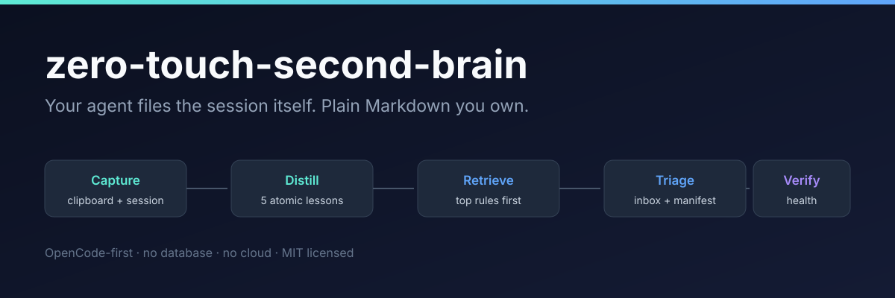
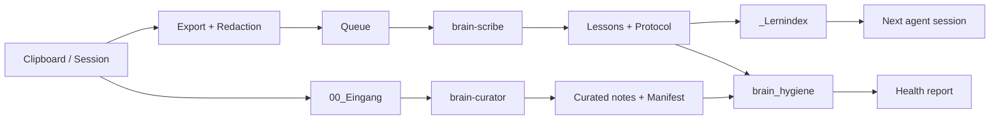

# zero-touch-second-brain

**Zero-touch memory for AI agents.** The agent files the session itself —
clipboard, learnings, inbox triage and vault hygiene — as plain Markdown you own.


OpenCode-first. No database, no vendor lock-in, no cloud requirement.

## Why

Most "AI second brain" setups still require you to decide what to save, where
to put it and when to clean up. This project automates the whole loop:

1. **Capture** — clipboard snippets and finished sessions become drafts.
2. **Distill** — a dedicated agent turns a session into at most five atomic
   lessons plus one protocol, deduplicated against existing lessons.
3. **Retrieve** — the next session reads a ten-rule index first and opens full
   lessons only when relevant.
4. **Triage** — the inbox agent files drafts with a manifest and an audit trail.
5. **Verify** — a hygiene check reports broken links, secrets and scheduler state.

## Quick start

```bash
git clone https://github.com/Letimba/zero-touch-second-brain.git
cd zero-touch-second-brain
bash scripts/install.sh
bash scripts/verify.sh
```

`install.sh` copies the agents and commands into your OpenCode config, creates
a minimal example vault under `$VAULT` (default `$HOME/SecondBrain`) and backs
up anything it replaces. Clipboard capture is **off** by default; enable it with
`CLIPBOARD_CAPTURE=1`.

## What you get

| Piece | Purpose |
|---|---|
| `agents/brain-scribe.md` | Session digest → atomic lessons + protocol |
| `agents/brain-curator.md` | Inbox triage with manifest and daily log |
| `commands/session-learn.md` | `/session-learn` — run the loop on demand |
| `commands/brain-status.md` | `/brain-status` — health and scheduler state |
| `AGENT-ROUTING.md` | One owner per work package, fallbacks, parallel limits |
| `SKILL-ROUTING.md` | Curated skill index instead of scanning hundreds of skills |
| `automation/` | Capture, export, orchestration, hygiene scripts |
| `examples/vault/` | Minimal, synthetic vault — no personal data |

## How it fits together



## Safety by design

- No secrets are stored. Tokens are read from the local OpenCode service config
  at runtime and compared only by length/prefix/hash.
- The export step redacts token-shaped strings. It does **not** redact names or
  project details — see `SECURITY.md` before publishing any generated digest.
- Raw layers are immutable: the curator writes new notes and a manifest; it
  never moves or deletes originals.
- `queue/`, `logs/` and `state/` are runtime data and are gitignored.

## Compatibility

Native support targets **OpenCode**. Community adapters for Claude Code,
Codex, Gemini CLI, Cursor and Windsurf are included since v0.2.0 — see
[Compatibility](docs/COMPATIBILITY.md). Only OpenCode has the full automated
loop; other CLIs receive the same retrieval/capture rules as context files.
Python 3.10+ uses only the standard library. On Linux/macOS, clipboard capture
needs an equivalent clipboard command; everything else works without Termux.

## Commands

| Command | Effect |
|---|---|
| `bash automation/brain-auto.sh` | One full cycle |
| `bash automation/brain-auto.sh --session-now` | Export and distill the latest session |
| `bash automation/brain-auto.sh --status` | Last run, health, queue |
| `python3 automation/brain_hygiene.py` | Vault, inbox, secrets, scheduler report |
| `bash scripts/verify.sh` | Release hygiene checks |

## FAQ

**Does it send data anywhere?** No. All steps run locally. The scheduler only
starts a local script.

**Does it read my chats?** Only the local OpenCode session API, and only when a
session export is triggered. Clipboard capture is opt-in.

**Can I use it without Obsidian?** Yes. The vault is plain Markdown; Obsidian
is a convenient viewer, not a runtime dependency.

**Where do the 10 lessons come from?** They are generated from your own
sessions, not shipped as a preset. The example vault contains only synthetic
placeholders.

## Docs

[Quick start](QUICKSTART.md) · [Architecture](docs/ARCHITECTURE.md) ·
[Learning loop](docs/LEARNING-LOOP.md) · [Security](SECURITY.md) ·
[FAQ](docs/FAQ.md) · [Roadmap](DISTRIBUTION-PLAN.md) ·
[Changelog](CHANGELOG.md) · [Compatibility](docs/COMPATIBILITY.md) · [Demo](docs/demo/index.html) · [Ecosystem](docs/OBSIDIAN-ECOSYSTEM.md)

## Contributing

See [CONTRIBUTING.md](CONTRIBUTING.md). Before a public release, run through
[RELEASE-CHECKLIST.md](RELEASE-CHECKLIST.md).

## License

MIT — see [LICENSE](LICENSE).
